# Fair multi-agent control of home batteries in a German neighbourhood

**Project period: May 2026 – October 2026.** I built it on my laptop and
pushed it to GitHub in October 2026, so the commit history here is short.
The steps are listed under [How the project developed](#how-the-project-developed).
A [distributed-optimisation part](#distributed-optimisation-added-november-2026)
(dual decomposition, ADMM, fairness) was added in November 2026.

[](https://github.com/MUmairSarwar/fair-multiagent-battery-control/actions/workflows/ci.yml)
[](LICENSE)

Six households share one local transformer, and each one has a home battery.
A learning agent controls each battery. Every 15 minutes it decides whether to
charge, discharge or wait, using the real 2025 German day-ahead electricity
prices. Charging when power is cheap saves money. The catch is that power is
cheap for everyone at the same time. If all batteries charge together, the
transformer is overloaded. The agents have to save money without doing that,
and the savings should be shared fairly.

I compare three multi-agent reinforcement learning methods with simple
baselines and with the best possible schedule. That schedule comes from a
linear program that knows all prices and loads in advance. It is the yardstick
for every result.

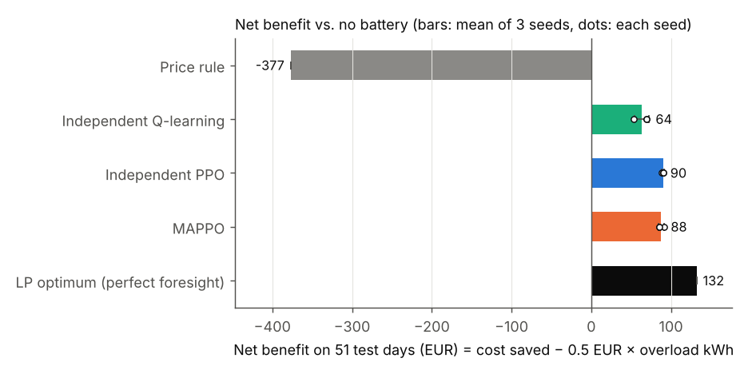


## Data period and version history

- **Observation period:** 2025 DE-LU electricity prices. Household demand is generated from the BDEW H0 profile with noise, rather than measured household records.
- **3 October 2026:** the price snapshot used by the current version was created in the German Energy Operations project.
- **17 October 2026:** the price series was checked against SMARD, and the battery-control code, experiments and reports were committed. See [data/README.md](data/README.md).
- **Earlier development:** May to October is the whole development period. The data snapshot, the SMARD check and the published results are from October.

## Main findings

All numbers are for 51 held-out test days of 2025, with 3 training seeds for
each learning method.

- **The simple price rule saves money but breaks the transformer.** Every
  household charges in the same cheap quarter-hours. That saves EUR 92.40 in
  energy cost, but the load goes over the limit in 293 of 4,896 quarter-hours,
  with a peak of 27.0 kW against an 11 kW limit. With the overload priced at
  EUR 0.5/kWh, the net result is −EUR 376.84.
- **The LP optimum gets EUR 132.06** with no overloads at all. This is the
  upper bound.
- **Independent PPO reached 68.2% ± 0.9% of the LP benefit** (EUR 90.01 ±
  1.19). MAPPO reached 66.4% ± 2.7%, and independent tabular Q-learning
  48.2% ± 6.9%. MAPPO, with its shared critic, did **not** beat independent
  PPO in this setting.
- **The learned policies still overload the transformer sometimes.** PPO went
  over the limit in 233 ± 45 quarter-hours, but by much less than the rule:
  58 kWh of overload against 939 kWh, and a 15.0 kW peak against 27.0 kW. The
  LP shows that zero overloads are possible.
- **Pricing the overload is what makes the agents behave.** When agents do not
  pay for overloads, they save the most on energy (PPO: EUR 135.41). But they
  overload in about 500 of 4,896 quarter-hours, and the net result becomes
  strongly negative.
- **The fairness reward and the 1-bit communication did not clearly help.**
  The differences are within the spread between seeds. Savings per kWh of
  battery were already fairly even without them (Jain index around 0.97 for
  every method, including the LP).

## The setting

| | |
|---|---|
| Households | 6, using 2,500 to 5,000 kWh per year |
| Batteries | 5, 7.5 or 10 kWh; max power 0.5 × capacity; 95% efficiency each way |
| Transformer limit | 11 kW for the six homes (assumption). Without batteries the peak is 6.4 kW; all batteries charging at once add 22.5 kW. |
| Overload penalty | EUR 0.5 per kWh above the limit (assumption) |
| Time step | 15 minutes; one episode = one day (96 steps), every battery starts half full |
| Actions | 5 levels per agent: discharge full / half, idle, charge half / full |
| Train / test | 312 / 51 days of 2025; every 7th day is held out for testing |

### Data

- **Prices:** 2025 day-ahead prices for the DE-LU bidding zone, from
  Bundesnetzagentur | [SMARD.de](https://www.smard.de/)
  ([CC BY 4.0](https://creativecommons.org/licenses/by/4.0/)). I got them
  through the [Energy-Charts API](https://api.energy-charts.info/) and checked
  them against SMARD's own series: same 35,040 quarter-hour values, same sum,
  minimum and maximum. Until 30 Sep 2025 prices were hourly, and from
  1 Oct 2025 every 15 minutes. Hourly prices are repeated for their four
  quarter-hours.
- **Household load:** the BDEW H0 standard load profile, with the
  dynamisation function, taken from [demandlib](https://github.com/oemof/demandlib).
  Hesse public holidays are counted as Sundays. Each household's curve is
  scaled to its yearly use, and each quarter-hour gets small random noise
  (lognormal, sigma 0.15).
- The two clock-change days are left out, so 363 days are used.
  Details: [data/README.md](data/README.md).

## Method

**Environment** ([src/fairbattery/env.py](src/fairbattery/env.py)). This is a
PettingZoo `ParallelEnv` that passes `parallel_api_test`. For training speed,
the same step code also runs as a batched numpy simulator that handles 16 days
side by side.

- Each agent sees its own battery level, the time of day and its current
  load. It also sees three features of the day-ahead price curve: the price
  relative to the day, its rank in the day, and the share of the rest of the
  day that is cheaper than now. With the incentive switched on, it also sees
  how loaded the transformer was in the last step.
- A battery can only discharge into its own house; it does not export to the
  grid.
- **Reward = saving.** A household's saving is its energy cost without a
  battery minus its cost with one, plus the change in stored energy valued at
  the day's average price. The last part stops an agent from "earning" money
  just by emptying a battery that started half full.
- **Price incentive (on by default):** overload energy is charged at
  EUR 0.5/kWh to the agents that were charging at that moment. With it off,
  the overload is only measured, not paid.
- **Fairness reward (optional):** each step, every agent loses
  `weight × mean capacity × (increase in the spread of savings per kWh of
  battery)`. Summed over a day, this penalises unequal savings.
- **1-bit communication (optional):** each agent also sends one bit per step.
  The others see what share of them sent a 1 in the last step.

**Baselines** ([src/fairbattery/baselines.py](src/fairbattery/baselines.py))

- *No battery.*
- *Price rule:* charge at full power in the cheapest 25% of the day's
  quarter-hours, discharge in the most expensive 25%.
- *LP optimum:* a linear program solved with scipy (HiGHS) for each day. It
  knows all prices and loads in advance and maximises exactly the score used
  for every method, total saving minus the overload penalty. No method that
  works under the same rules can beat it.

**Agents** ([src/fairbattery/agents.py](src/fairbattery/agents.py))

- *Independent tabular Q-learning:* one table per agent over 600 binned states.
  2,000 iterations × 16 days.
- *Independent PPO:* one actor and one critic per agent, each seeing only that
  agent's observation. 400 iterations × 16 days.
- *MAPPO:* the same per-agent actors, plus one shared critic that sees all
  agents' observations during training. When acting, each agent still uses
  only its own observation.

**Metrics** ([src/fairbattery/metrics.py](src/fairbattery/metrics.py)):

- energy cost saved
- overload steps and overload energy
- net benefit (= saving − penalty × overload)
- peak load
- Jain's fairness index of each household's saving per kWh of battery
- net benefit as a share of the LP's (the gap to the optimum)

All methods are scored on the same 51 test days with the same noisy loads.

## Results

### Main setting (overload price on, no fairness reward, no communication)

Mean ± standard deviation over 3 seeds. The 51 test days have 4,896
quarter-hours in total. Without batteries, the energy cost of the six homes on
these days is EUR 315.72.

| Method | Energy cost saved (EUR) | Overload steps | Overload energy (kWh) | Net benefit (EUR) | Share of LP benefit | Peak load (kW) | Jain index |
|:--|--:|--:|--:|--:|--:|--:|--:|
| No battery | 0.00 | 0 | 0.0 | 0.00 | 0% | 6.42 | n/a |
| Price rule | 92.40 | 293 | 938.5 | −376.84 | negative | 26.96 | 0.969 |
| LP optimum (perfect foresight) | 132.06 | 0 | 0.0 | 132.06 | 100% | 11.00 | 0.969 |
| Independent Q-learning | 72.69 ± 6.16 | 68 ± 20 | 18.1 ± 6.2 | 63.65 ± 9.08 | 48.2 ± 6.9% | 15.72 ± 1.75 | 0.974 ± 0.026 |
| Independent PPO | 118.95 ± 1.77 | 233 ± 45 | 57.9 ± 4.5 | **90.01 ± 1.19** | **68.2 ± 0.9%** | 14.99 ± 0.17 | 0.965 ± 0.007 |
| MAPPO | 120.90 ± 0.44 | 303 ± 23 | 66.5 ± 7.9 | 87.66 ± 3.62 | 66.4 ± 2.7% | 15.04 ± 0.00 | 0.967 ± 0.002 |

The savings are measured against the wholesale energy part of the bill only;
see the limitations.

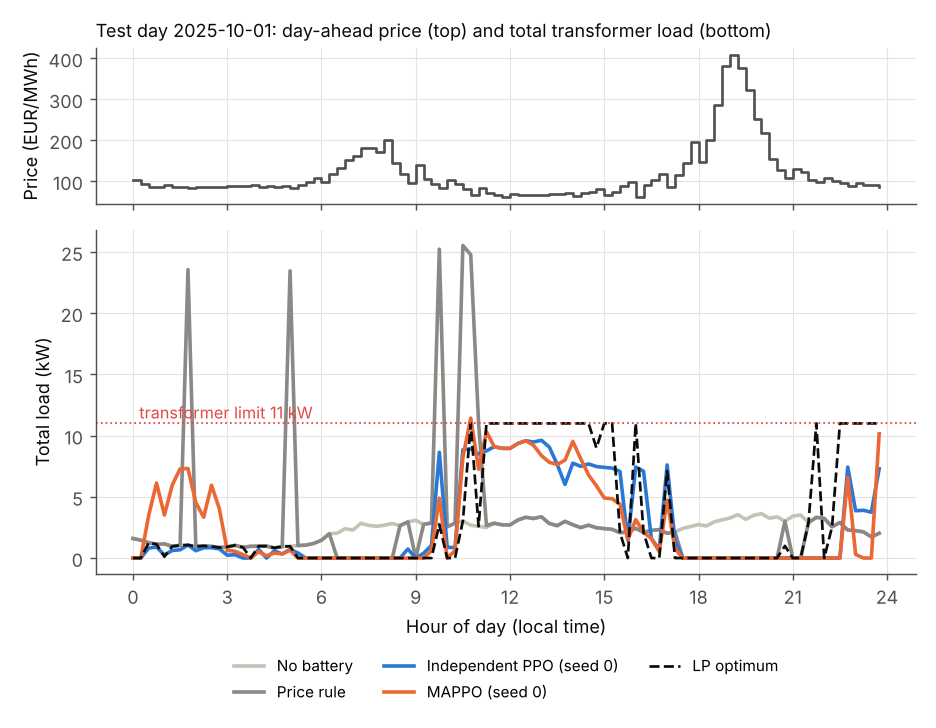

On this day (1 Oct 2025, the first day with 15-minute prices), the price rule
sends the load to about 25 kW four times. The PPO agents spread their charging
over the cheap midday hours and stay mostly under the limit. The LP fills the
transformer exactly up to 11 kW.

### Experiments

| Setting | Method | Energy cost saved (EUR) | Overload steps | Net benefit (EUR) | Share of LP benefit | Jain index |
|:--|:--|--:|--:|--:|--:|--:|
| Main | Q-learning | 72.69 ± 6.16 | 68 ± 20 | 63.65 ± 9.08 | 48.2 ± 6.9% | 0.974 ± 0.026 |
| Main | IPPO | 118.95 ± 1.77 | 233 ± 45 | 90.01 ± 1.19 | 68.2 ± 0.9% | 0.965 ± 0.007 |
| Main | MAPPO | 120.90 ± 0.44 | 303 ± 23 | 87.66 ± 3.62 | 66.4 ± 2.7% | 0.967 ± 0.002 |
| + fairness reward (weight 2) | Q-learning | 69.89 ± 5.01 | 111 ± 33 | 52.23 ± 14.81 | 39.5 ± 11.2% | 0.975 ± 0.027 |
| + fairness reward (weight 2) | IPPO | 116.29 ± 0.39 | 215 ± 69 | 84.84 ± 4.43 | 64.2 ± 3.4% | 0.975 ± 0.010 |
| + fairness reward (weight 2) | MAPPO | 119.27 ± 3.11 | 231 ± 40 | 83.87 ± 16.73 | 63.5 ± 12.7% | 0.966 ± 0.012 |
| No overload price for agents | Q-learning | 69.47 ± 2.81 | 407 ± 39 | −215.85 ± 32.94 | negative | 0.955 ± 0.014 |
| No overload price for agents | IPPO | 135.41 ± 0.92 | 497 ± 6 | −506.54 ± 10.46 | negative | 0.985 ± 0.003 |
| No overload price for agents | MAPPO | 131.71 ± 0.85 | 529 ± 12 | −417.06 ± 36.02 | negative | 0.982 ± 0.002 |
| + 1-bit communication | Q-learning | 63.32 ± 2.86 | 85 ± 14 | 49.00 ± 5.00 | 37.1 ± 3.8% | 0.984 ± 0.010 |
| + 1-bit communication | IPPO | 116.17 ± 3.91 | 202 ± 93 | 90.02 ± 6.85 | 68.2 ± 5.2% | 0.967 ± 0.004 |
| + 1-bit communication | MAPPO | 117.98 ± 2.14 | 224 ± 33 | 88.10 ± 1.51 | 66.7 ± 1.1% | 0.966 ± 0.002 |

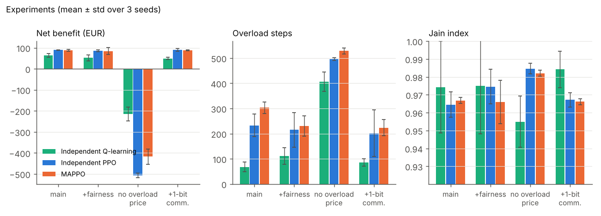

What I read from this:

- **Overload price on vs. off** is the one clear effect. Without it, each agent
  behaves like the price rule: it charges whenever power is cheap, because the
  overload costs it nothing. The agents then save more on energy, but the
  system is far worse off.
- **Fairness reward.** IPPO's Jain index went from 0.965 to 0.975, but the
  seeds overlap and the net benefit dropped a little for all three methods.
  The fairness problem was small to begin with: the LP's own schedule already
  has a Jain index of 0.969.
- **1-bit communication.** IPPO had fewer overload steps on average (202 vs.
  233), but the spread between seeds (± 93) is larger than the difference.
  Q-learning got worse, probably because the message doubles its number of
  actions and of states it can visit, so each table entry is seen less often.
- **MAPPO vs. IPPO.** The shared critic gave no gain here. One possible reason
  is that the overload price already tells each agent most of what it needs
  to know about the others. I have not tested this.

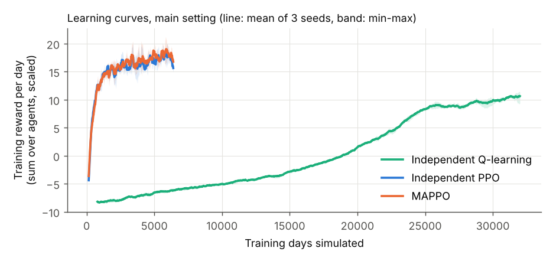

Q-learning was still improving when training stopped. With a longer run it
would probably do better, so its numbers should be read as "after 32,000
training days", not as the limit of the method.

## Distributed optimisation (added November 2026)

The LP above is centralised: one solver sees every household's load and
battery. A real neighbourhood would rather let each household decide for
itself, with only a little coordination. The problem has the right shape for
that: each household's cost and constraints are its own, and only the
transformer limit couples them. So the same problem was also solved with two
classic distributed methods ([src/fairbattery/distributed/](src/fairbattery/distributed/),
derivations in [docs/theory.md](docs/theory.md)):

- **Dual decomposition.** The coordinator publishes a *congestion price* per
  quarter-hour (the dual variable of the transformer limit). Each household
  solves its own small LP with that extra price and reports its plan. The
  price rises where the transformer is overloaded (projected subgradient
  steps), and the averaged plans are reported.
- **ADMM for the sharing problem** (Boyd et al. 2011, §7.3). Each household
  solves a small QP; the coordinator's step has a closed form.

In both, a household only receives 96 numbers per round and sends 96 back.
It never shares its load or battery data.

Same 51 test days and loads as the main results:

| Method | Net benefit (EUR) | Share of LP (%) | Overload (kWh, 51 days) | Days within 1% of the LP |
|---|---:|---:|---:|---:|
| Centralised LP (published bound) | 132.06 | 100.00 | 0.00 | – |
| Exact MILP (no simultaneous charge/discharge) | 132.05 | 100.00 | 0.00 | – |
| Dual decomposition, 300 rounds | 131.28 | 99.42 | 0.72 | 44 / 51 |
| ADMM, rho = 0.5 | 132.05 | 99.99 | 0.01 | 51 / 51 |

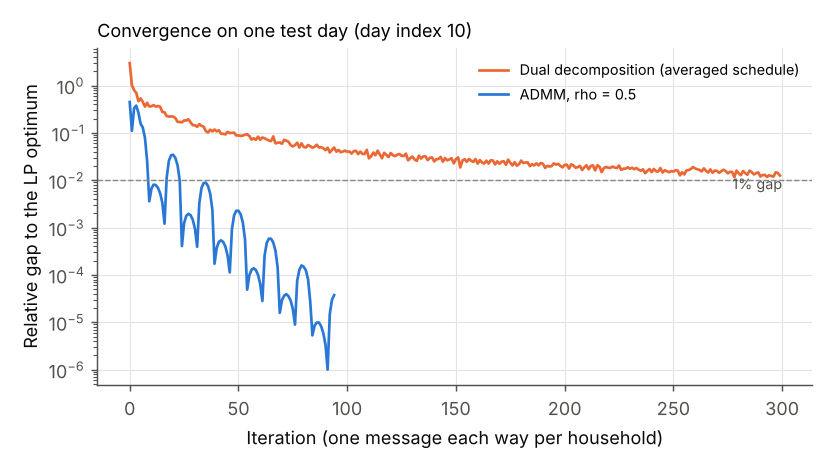

- **ADMM reaches the centralised optimum** on every test day. It needs a
  median of 21 rounds to get within 1%. Dual decomposition needs a median of
  about 130 rounds and misses 1% on 7 days in 300 rounds. That is the
  expected behaviour of a subgradient method on an LP: the household plans
  jump between corners, so only their average settles.
- **Exact MILP vs LP.** On the 3 test days where the LP charges and discharges
  at once, forbidding it lowers the total benefit by EUR 0.002. The LP bound
  used for the RL results is therefore essentially exact.

### Putting fairness into the algorithm

With a hard transformer limit, the transformer capacity was shared under
three rules. Each compares households by saving per kWh of battery:
*efficient* (largest total saving), *proportional fairness*
(sum of log savings, Kelly 1998) and *max-min fairness* (raise the worst-off
household first). Proportional fairness keeps the problem separable, so it
also runs inside ADMM: only each household's local objective changes.

| Allocation | Total saving (EUR) | Price of fairness (%) | Jain index | Lowest saving per kWh (EUR) | Highest (EUR) |
|---|---:|---:|---:|---:|---:|
| Efficient | 132.06 | 0.00 | 0.974 | 2.27 | 3.81 |
| Proportional fairness | 132.03 | 0.02 | 0.994 | 2.59 | 3.35 |
| Max-min fairness (per day) | 118.20 | 10.49 | 1.000 | 2.62 | 2.63 |
| Proportional fairness, distributed (ADMM) | 132.03 | 0.02 | 0.994 | 2.59 | 3.35 |

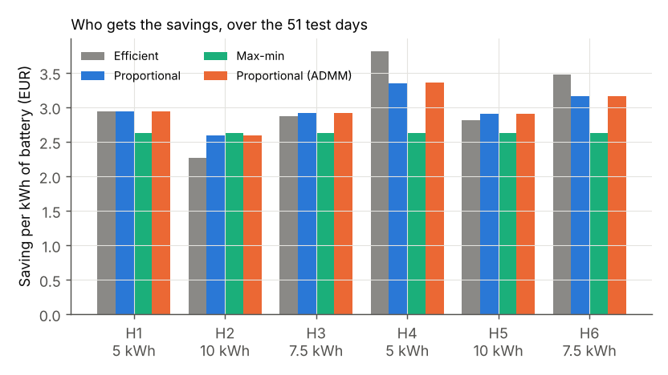

- **Proportional fairness is almost free here.** It costs 0.02% of the total
  but raises the worst-off household (H2, the 10 kWh battery) by 14%. The
  efficient optimum is not unique: many schedules give the same total, and
  they share it differently. That is also why its Jain index (0.974) differs
  slightly from the main LP table (0.969). Proportional fairness picks a fair
  one among nearly equally good schedules.
- **Max-min fairness is expensive.** Equalising everyone exactly costs 10.5%
  of the total saving. It does so mostly by holding back H4 and H6, the
  households that gain most per kWh of battery.
- **The distributed version matches the centralised one** (largest
  transformer violation 0.001 kWh).

### Scaling

The six household types were copied to 24 and 96 synthetic households, with
the transformer limit scaled in proportion (2 days each).

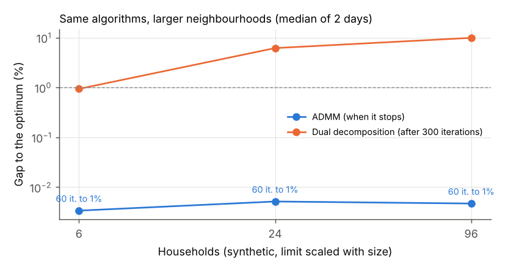

- ADMM needed about **60 rounds to reach 1% for 6, 24 and 96 households
  alike**, at about 4 ms per household solve.
- Dual decomposition, with the step size tuned for 6 households, was still
  5–11% from the optimum after 300 rounds for 24 and 96. Its step should
  shrink as the number of households grows. That was not re-tuned, so this
  comparison favours ADMM.

What this part does **not** show yet: forecast errors, a network model with
voltages, communication delays, or a proof beyond the standard theorems it
relies on. Those are listed in [docs/theory.md](docs/theory.md#6-limitations).

## Limitations

- **Only the wholesale part of the bill.** Households pay the day-ahead price
  only, so the percentage savings (for example 37.7% for IPPO) are much
  higher than a real bill would show. Grid fees, taxes and levies are not
  modelled, and these add a fixed amount per kWh. That amount does not change
  when to charge, but it does make battery losses more expensive.
- **Assumed transformer limit and penalty.** The 11 kW limit and the
  EUR 0.5/kWh penalty are my assumptions, chosen so that the limit matters.
  They are not taken from a real distribution network. Other values would
  change the numbers.
- **Synthetic households.** The loads are the H0 standard profile plus noise,
  not measured smart-meter data. Real households differ much more from each
  other, and there are no solar panels, heat pumps or electric cars.
- **Perfect short-term information.** Agents see their own load for the
  current quarter-hour, and everyone knows the day-ahead prices for the whole
  day. That second part is realistic, because the auction clears the day
  before.
- **The LP has a few small advantages.** It uses continuous power instead of
  5 levels. In 212 of 29,376 household-steps it charges and discharges at the
  same time, which only pays off when prices are zero or negative and the
  battery is full. Its score is therefore a slightly generous upper bound. An
  exact mixed-integer version that forbids this (`solve_day_lp(...,
  exclusive=True)`) changes the 51-day benefit by less than one cent; see
  [docs/theory.md](docs/theory.md#5-the-lp-relaxation-artefact).
- **End-of-day valuation.** Stored energy left at midnight is valued at the
  day's average price. This is why the LP sometimes charges late in the
  evening.
- **Small experiment.** Six households, one year, 3 seeds and no
  hyperparameter search. The differences between IPPO, MAPPO and the
  variants are mostly within the spread between seeds.
- **Test days spread over the year.** Every 7th day is held out rather than
  a later period, so the test set covers all seasons and both price
  resolutions.

## Reproduce

Tested with Python 3.13 on Linux. CI uses Python 3.12.

```bash
python -m venv .venv
source .venv/bin/activate
pip install -r requirements.txt
python scripts/reproduce.py        # data -> 36 training runs -> tables and figures
```

On a 2-core machine, the full run took about 30 minutes: about 110 s per PPO
run and 50 s per Q-learning run, on one CPU thread each. The seeds are fixed,
and running the same seed again gives the same numbers. A short check that
everything runs:

```bash
python -m pytest -q
python scripts/run_experiments.py --quick
```

The distributed-optimisation results (about 40 minutes on 2 cores):

```bash
python scripts/run_distributed.py           # writes results/distributed/
python scripts/run_distributed.py --quick --out /tmp/distributed   # short check
```

Settings are in [configs/default.yaml](configs/default.yaml) and
[configs/experiments.yaml](configs/experiments.yaml).

## Repository structure

```text
src/fairbattery/    data loading, environment, baselines, agents, metrics, experiment runner
src/fairbattery/distributed/   dual decomposition, ADMM, fairness objectives, centralised references
docs/theory.md      derivations behind the distributed algorithms
configs/            default settings and the experiment variants
scripts/            prepare_data.py, run_experiments.py, make_report.py, reproduce.py, run_distributed.py
tests/              pytest: data, PettingZoo API, battery physics, LP, metrics, agents
data/               raw price file, processed inputs, data notes
results/            per-run JSON, tables (CSV/Markdown) and figures
```

## How the project developed

I started in May 2026 and worked on it alongside other things until October.
Roughly in this order:

1. **Data.** Getting the 2025 day-ahead prices, checking them against SMARD,
   and handling the switch from hourly to 15-minute prices on 1 Oct 2025.
   Building the household loads from the H0 profile.
2. **Environment.** Writing the PettingZoo environment and the battery
   physics, then the batched numpy version once training got too slow.
3. **Baselines.** The price rule and the LP. The LP came early on purpose, so
   that every later result had a fixed target to compare against.
4. **Learning agents.** Tabular Q-learning first, then independent PPO, then
   MAPPO. This was my first RL project, so most of the time went here.
5. **Experiments.** The fairness reward, the 1-bit messages and switching the
   overload price off. Three seeds each, 36 runs in total.
6. **Write-up.** Tables, figures, tests, CI and this README. Then publishing
   it in October.
7. **Distributed optimisation (November 2026).** Dual decomposition, ADMM
   and fairness objectives on the same problem, plus the exact MILP check of
   the LP. The derivations are in [docs/theory.md](docs/theory.md).

## Background

My M.Phil. thesis was about two-player zero-sum matrix games solved with
linear programming. This project was my way into the multi-agent side of that
area: several agents that share a limited resource and learn instead of
being solved for. It was also my first reinforcement learning project.

## Licence and attribution

Code: [MIT](LICENSE). Price data: Bundesnetzagentur | SMARD.de,
[CC BY 4.0](https://creativecommons.org/licenses/by/4.0/). Load profile: BDEW
H0 via demandlib (MIT).

Author: [Muhammad Umair Sarwar](https://github.com/MUmairSarwar) ·
[LinkedIn](https://www.linkedin.com/in/muhammad-umair-sarwar/)

## Distributed optimization: audited extension

This additional implementation preserves the existing `run_distributed.py` workflow and public API.
The original soft-limit solver modules remain available; the additional hard-limit experiments below use explicit module imports.
Stage 0 compatibility functions live in `src/fairbattery/stage0_baselines.py`.


This extension was built as a learning project with AI assistance. Mathematical notes are in [docs/theory.md](docs/theory.md).
They are currently an **AI-assisted study draft for the author to verify and
rewrite**, not yet independently authored derivations. The final authorship
statement will be updated after that work is completed.

### Stage 0: remove simultaneous battery charging and discharging

Implemented in `src/fairbattery/distributed/centralised.py`, with compatibility
entry points in `src/fairbattery/stage0_baselines.py`:

- `run_lp(env)`: original continuous relaxation, retained to reproduce the
  published MARL comparison. It permits simultaneous operation.
- `run_corrected_lp(env)`: adds a mathematically sufficient throughput fee
  computed over the current batch, and checks that no cycles remain. This is
  the proposed convex reference for the later distributed LP algorithms.
- `run_milp(env)`: enforces exclusive operating modes with binary variables,
  retaining the original economic objective. This is a physical reference,
  **not** an LP to which standard convex strong-duality guarantees apply.

A small arbitrary fee is not enough at all negative prices. The sufficient
fee here is `max(0, -min(price)) * (1-eta**2)/(1+eta**2) + 1e-6` EUR per kWh
charged plus discharged. It is a modelling penalty, not a calibrated battery
wear cost. The proof and its assumptions are in the theory notes.

All variants retain the existing **soft** 11 kW transformer penalty, the daily
half-full initial SOC and the terminal stored-energy valuation. Stages 1–4 below explicitly switch to a hard transformer limit.

Reproduce from the repository root (Python and existing dependencies installed):

```bash
python scripts/audit_stage0.py --include-milp
python -m pytest tests/test_baselines.py tests/test_distributed_stage0.py tests/test_data.py tests/test_metrics.py tests/test_env.py -q
```

For a quicker LP-only comparison, omit `--include-milp`. Neither command
re-trains or changes the MARL agents. The script regenerates both Stage 0
figures, schedules (`.npz`), a comparison CSV and a JSON with seed, data/config
hashes, dates, software versions and solver gaps, under
`results/distributed/stage0/`.

The optional MILP uses a relative gap of `1e-5` and a 60-second per-day limit;
a time-limited or otherwise unsuccessful solve raises. Tightening this to
`1e-9` timed out on one negative-price day in this environment. Runtime depends
on the machine and solver version. Mode exclusivity is checked at `1e-6` kWh.

The LP fee changes the optimized objective. Therefore `net_benefit_eur` always
reports the **original** economic score without the throughput fee, and
`objective_eur` separately reports minimized cost **including** that fee.
The original cost is negative net benefit. No penalized objective is compared
to an unpenalized objective as though they were the same problem.

All figures below use the same 51 held-out days and seed 2025. Counts are
household-steps (29,376 in total), using a 1e-6 kWh overlap threshold.

| Model | Fee (EUR/kWh throughput) | Simultaneous household-steps | Original net benefit (EUR) | Loss vs relaxed LP (EUR) |
|---|---:|---:|---:|---:|
| original_lp | 0.000000000 | 212 | 132.055004 | 0.000000 |
| small_fee_lp | 0.000100000 | 12 | 132.050951 | 0.004053 |
| sufficient_fee_lp | 0.001631723 | 0 | 131.928555 | 0.126449 |
| exclusive_milp | 0.000000000 | 0 | 132.053306 | 0.001698 |

All four schedules have zero transformer overload within numerical tolerance.
MILP values are certified to the recorded relative MIP gap (at most 1e-5),
not exact arithmetic optimality. The MILP still allows continuous power.
The sufficient fee eliminates cycling but also discourages useful arbitrage;
this explains its larger economic-benefit reduction.

The original 212 cycling cases are 208 negative-price and 4 zero-price
household-steps. These are not 212 distinct clock intervals.

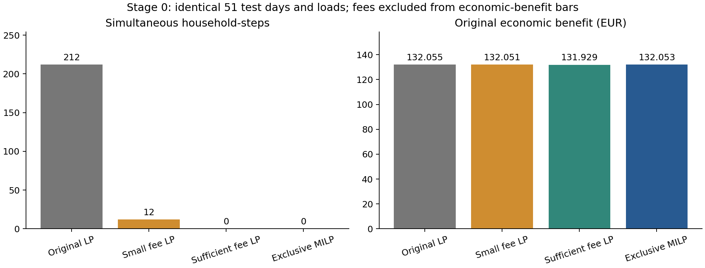
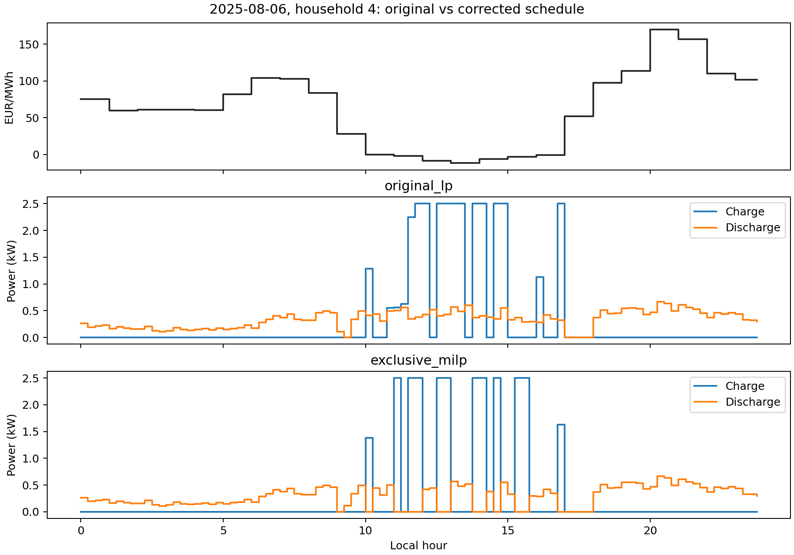

### Stages 1–4: distributed solvers, fairness and scaling

The new package is `src/fairbattery/distributed/`. `model.py` defines the hard-capacity,
throughput-penalized LP; `local.py` contains private household LP/QP oracles;
`algorithms.py` implements price-based dual decomposition and sharing ADMM;
`fairness.py` supplies log-savings and lexicographic max-min references.
`datasets.py` preserves the original BDEW H0 load-generation method.

The only coupling constraint is total transformer import. Each household solves
using its own load and battery parameters and a broadcast price/allocation.
A coordinator aggregates imports; the implementation simulates these messages
in one Python process. It is not a deployed network or a privacy protocol.

Dual decomposition uses diminishing price steps, weighted primal averaging and
an idle-schedule blend for finite-iteration feasibility. ADMM uses the two-block
sharing formulation of Boyd et al. (2011), Section 7.3. The notes derive the
Lagrangian, strong duality, local updates, projection, residuals and recovery.
The central LP is independently checked against CVXPY on three 2025 dates.

Reproduce all distributed experiments and figures:

```bash
python -m pip install -r requirements.txt
python scripts/reproduce_distributed.py
python -m pytest -q
```

Use `python scripts/reproduce_distributed.py --include-stage0` to also rerun the
51-day Stage 0 audit including the MILP. Use `python scripts/plot_distributed.py`
to regenerate Stages 1–4 figures from stored CSVs without solving again.
`python scripts/distributed_experiments.py --skip-scaling` runs the smaller
experiments only. Full scaling includes 1,000 local solvers and takes minutes.

Measured results, histories, settings, versions and the input SHA-256 are in
[`results/distributed/complete`](results/distributed/complete). The dual tolerance
is a primal–dual certificate in EUR per household; ADMM uses residual RMS.
Objective gaps are separately measured against the identical central problem.
The rho sweep deliberately retains a run that reaches its iteration limit;
small objective error alone is not labelled convergence.


Measured scaling on 7 January 2025 (seed 2025):

| Homes | Method | Iterations | Runtime (s) | Total objective gap (EUR) | Messages/agent |
|---:|---|---:|---:|---:|---:|
| 6 | dual | 920 | 1.57 | 0.0036194 | 1840 |
| 6 | admm | 270 | 0.92 | 2.01361e-07 | 540 |
| 100 | dual | 740 | 19.22 | 0.0026767 | 1480 |
| 100 | admm | 250 | 17.51 | 1.78707e-05 | 500 |
| 1000 | dual | 870 | 258.54 | 0.413121 | 1740 |
| 1000 | admm | 230 | 136.48 | 0.00197363 | 460 |

All six scaling runs met their stated stopping rule and returned schedules with
zero transformer violation to numerical precision. On the three six-household
comparison days, ADMM objective gaps were below 0.000007 EUR. The May dual run
reached its iteration cap despite a 0.002329 EUR objective gap; its `converged`
flag is false. Centralized solving is faster at these sizes in this serial setup.

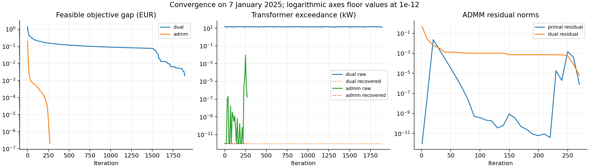
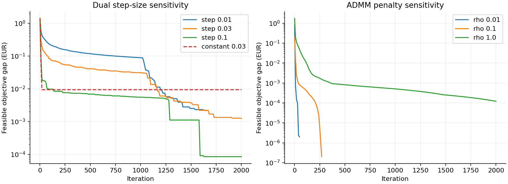
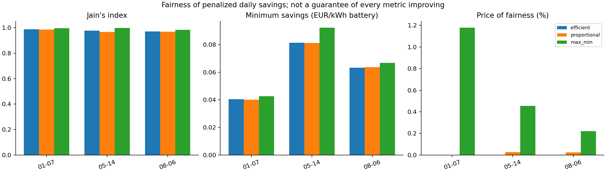
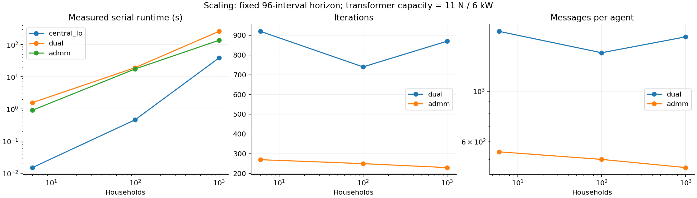

Fairness concerns daily savings per kWh of installed battery, relative to an idle
battery, including throughput cost and terminal valuation. Proportional fairness
maximizes log savings; max-min progressively freezes bottleneck households.
These allocate transformer access through time-varying battery schedules.
The comparison reports Jain's index, lowest normalized saving and efficiency
loss. Log fairness does not guarantee that Jain's index increases. Max-min is a
centralized lexicographic reference; efficient dual/ADMM and the additional
log-savings ADMM use local household solves.

Limitations: perfect day-ahead prices, synthetic household loads, independent
daily half-full SOC, idle-feasible recovery, finite solver tolerances, no export,
no battery aging calibration, no communication delays or packet loss. Scaling
holds the 96-step horizon fixed and scales capacity as `11*N/6` kW; keeping an
11 kW transformer for 1,000 homes would be a different, generally infeasible
experiment. Runtimes measure serial execution, not parallel speedup. Fairness
is evaluated for six homes, not claimed to scale lexicographic solves to 1,000.

Validation: all 46 tests passed after integration with the latest main branch,
including its existing distributed solver tests and the additional audit tests. The proportional ADMM experiment on 14 May converged
in 640 iterations, with log-utility gap 8.28e-6 against central CVXPY. Its
penalized savings were EUR 4.676598, with a 0.0274% efficiency loss. One local
Clarabel solve emitted an accuracy warning and was re-solved using the SCS
fallback; no inaccurate solver status is accepted as a successful local solve.
