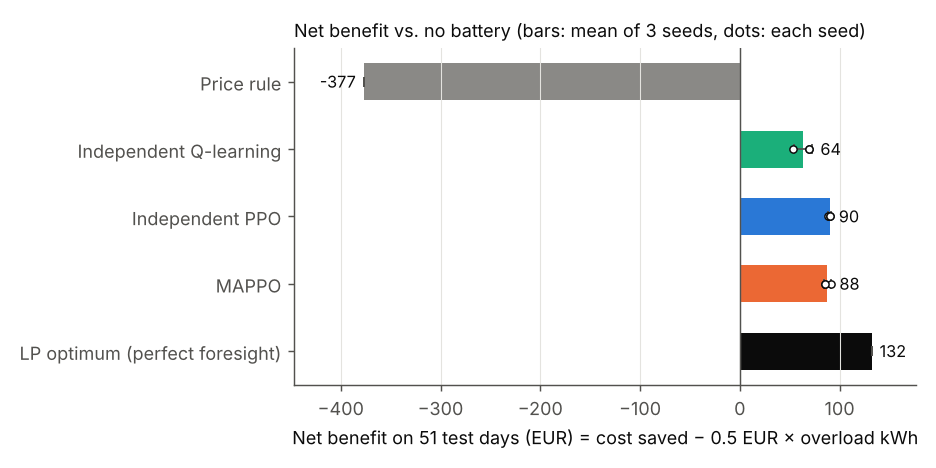
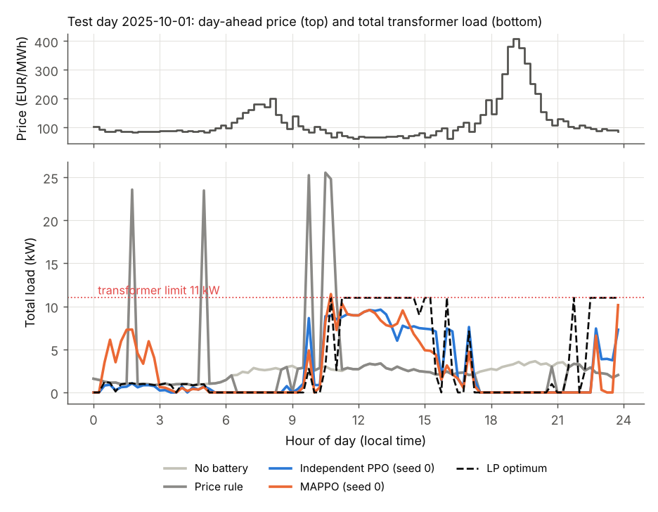
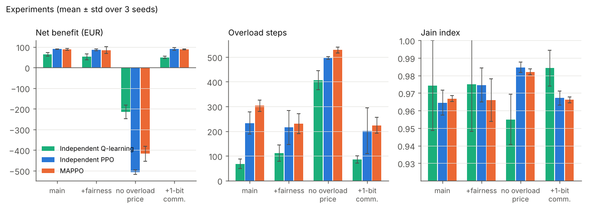
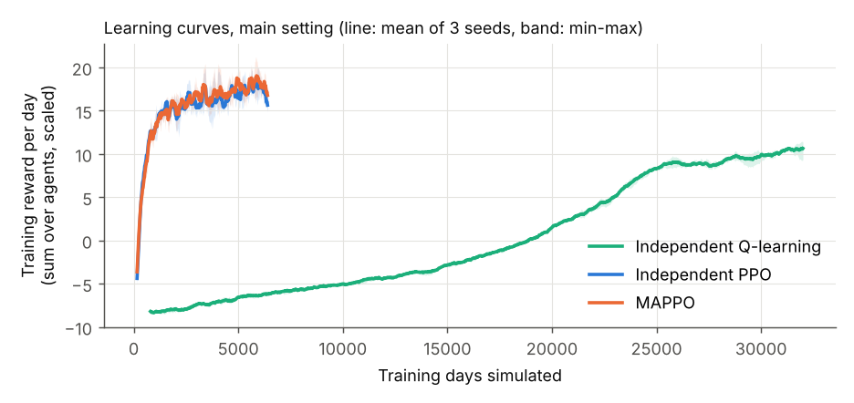

# Fair multi-agent control of home batteries in a German neighbourhood

[](https://github.com/MUmairSarwar/fair-multiagent-battery-control/actions/workflows/ci.yml)
[](LICENSE)

Six households share one local transformer, and each one has a home battery.
A learning agent controls each battery. Every 15 minutes it decides whether to
charge, discharge or wait, using the real 2025 German day-ahead electricity
prices. Charging when power is cheap saves money. The catch is that power is
cheap for everyone at the same time. If all batteries charge together, the
transformer is overloaded. The agents have to save money without doing that,
and the savings should be shared fairly.

I compare three multi-agent reinforcement learning methods with simple
baselines and with the best possible schedule. That schedule comes from a
linear program that knows all prices and loads in advance. It is the yardstick
for every result.



## Main findings

All numbers are for 51 held-out test days of 2025, with 3 training seeds for
each learning method.

- **The simple price rule saves money but breaks the transformer.** Every
  household charges in the same cheap quarter-hours. That saves EUR 92.40 in
  energy cost, but the load goes over the limit in 293 of 4,896 quarter-hours,
  with a peak of 27.0 kW against an 11 kW limit. With the overload priced at
  EUR 0.5/kWh, the net result is −EUR 376.84.
- **The LP optimum gets EUR 132.06** with no overloads at all. This is the
  upper bound.
- **Independent PPO reached 68.2% ± 0.9% of the LP benefit** (EUR 90.01 ±
  1.19). MAPPO reached 66.4% ± 2.7%, and independent tabular Q-learning
  48.2% ± 6.9%. MAPPO, with its shared critic, did **not** beat independent
  PPO in this setting.
- **The learned policies still overload the transformer sometimes.** PPO went
  over the limit in 233 ± 45 quarter-hours, but by much less than the rule:
  58 kWh of overload against 939 kWh, and a 15.0 kW peak against 27.0 kW. The
  LP shows that zero overloads are possible.
- **Pricing the overload is what makes the agents behave.** When agents do not
  pay for overloads, they save the most on energy (PPO: EUR 135.41). But they
  overload in about 500 of 4,896 quarter-hours, and the net result becomes
  strongly negative.
- **The fairness reward and the 1-bit communication did not clearly help.**
  The differences are within the spread between seeds. Savings per kWh of
  battery were already fairly even without them (Jain index around 0.97 for
  every method, including the LP).

## The setting

| | |
|---|---|
| Households | 6, using 2,500 to 5,000 kWh per year |
| Batteries | 5, 7.5 or 10 kWh; max power 0.5 × capacity; 95% efficiency each way |
| Transformer limit | 11 kW for the six homes (assumption). Without batteries the peak is 6.4 kW; all batteries charging at once add 22.5 kW. |
| Overload penalty | EUR 0.5 per kWh above the limit (assumption) |
| Time step | 15 minutes; one episode = one day (96 steps), every battery starts half full |
| Actions | 5 levels per agent: discharge full / half, idle, charge half / full |
| Train / test | 312 / 51 days of 2025; every 7th day is held out for testing |

### Data

- **Prices:** 2025 day-ahead prices for the DE-LU bidding zone, from
  Bundesnetzagentur | [SMARD.de](https://www.smard.de/)
  ([CC BY 4.0](https://creativecommons.org/licenses/by/4.0/)). I got them
  through the [Energy-Charts API](https://api.energy-charts.info/) and checked
  them against SMARD's own series: same 35,040 quarter-hour values, same sum,
  minimum and maximum. Until 30 Sep 2025 prices were hourly, and from
  1 Oct 2025 every 15 minutes. Hourly prices are repeated for their four
  quarter-hours.
- **Household load:** the BDEW H0 standard load profile, with the
  dynamisation function, taken from [demandlib](https://github.com/oemof/demandlib).
  Hesse public holidays are counted as Sundays. Each household's curve is
  scaled to its yearly use, and each quarter-hour gets small random noise
  (lognormal, sigma 0.15).
- The two clock-change days are left out, so 363 days are used.
  Details: [data/README.md](data/README.md).

## Method

**Environment** ([src/fairbattery/env.py](src/fairbattery/env.py)). This is a
PettingZoo `ParallelEnv` that passes `parallel_api_test`. For training speed,
the same step code also runs as a batched numpy simulator that handles 16 days
side by side.

- Each agent sees its own battery level, the time of day and its current
  load. It also sees three features of the day-ahead price curve: the price
  relative to the day, its rank in the day, and the share of the rest of the
  day that is cheaper than now. With the incentive switched on, it also sees
  how loaded the transformer was in the last step.
- A battery can only discharge into its own house; it does not export to the
  grid.
- **Reward = saving.** A household's saving is its energy cost without a
  battery minus its cost with one, plus the change in stored energy valued at
  the day's average price. The last part stops an agent from "earning" money
  just by emptying a battery that started half full.
- **Price incentive (on by default):** overload energy is charged at
  EUR 0.5/kWh to the agents that were charging at that moment. With it off,
  the overload is only measured, not paid.
- **Fairness reward (optional):** each step, every agent loses
  `weight × mean capacity × (increase in the spread of savings per kWh of
  battery)`. Summed over a day, this penalises unequal savings.
- **1-bit communication (optional):** each agent also sends one bit per step.
  The others see what share of them sent a 1 in the last step.

**Baselines** ([src/fairbattery/baselines.py](src/fairbattery/baselines.py))

- *No battery.*
- *Price rule:* charge at full power in the cheapest 25% of the day's
  quarter-hours, discharge in the most expensive 25%.
- *LP optimum:* a linear program solved with scipy (HiGHS) for each day. It
  knows all prices and loads in advance and maximises exactly the score used
  for every method, total saving minus the overload penalty. No method that
  works under the same rules can beat it.

**Agents** ([src/fairbattery/agents.py](src/fairbattery/agents.py))

- *Independent tabular Q-learning:* one table per agent over 600 binned states.
  2,000 iterations × 16 days.
- *Independent PPO:* one actor and one critic per agent, each seeing only that
  agent's observation. 400 iterations × 16 days.
- *MAPPO:* the same per-agent actors, plus one shared critic that sees all
  agents' observations during training. When acting, each agent still uses
  only its own observation.

**Metrics** ([src/fairbattery/metrics.py](src/fairbattery/metrics.py)):

- energy cost saved
- overload steps and overload energy
- net benefit (= saving − penalty × overload)
- peak load
- Jain's fairness index of each household's saving per kWh of battery
- net benefit as a share of the LP's (the gap to the optimum)

All methods are scored on the same 51 test days with the same noisy loads.

## Results

### Main setting (overload price on, no fairness reward, no communication)

Mean ± standard deviation over 3 seeds. The 51 test days have 4,896
quarter-hours in total. Without batteries, the energy cost of the six homes on
these days is EUR 315.72.

| Method | Energy cost saved (EUR) | Overload steps | Overload energy (kWh) | Net benefit (EUR) | Share of LP benefit | Peak load (kW) | Jain index |
|:--|--:|--:|--:|--:|--:|--:|--:|
| No battery | 0.00 | 0 | 0.0 | 0.00 | 0% | 6.42 | n/a |
| Price rule | 92.40 | 293 | 938.5 | −376.84 | negative | 26.96 | 0.969 |
| LP optimum (perfect foresight) | 132.06 | 0 | 0.0 | 132.06 | 100% | 11.00 | 0.969 |
| Independent Q-learning | 72.69 ± 6.16 | 68 ± 20 | 18.1 ± 6.2 | 63.65 ± 9.08 | 48.2 ± 6.9% | 15.72 ± 1.75 | 0.974 ± 0.026 |
| Independent PPO | 118.95 ± 1.77 | 233 ± 45 | 57.9 ± 4.5 | **90.01 ± 1.19** | **68.2 ± 0.9%** | 14.99 ± 0.17 | 0.965 ± 0.007 |
| MAPPO | 120.90 ± 0.44 | 303 ± 23 | 66.5 ± 7.9 | 87.66 ± 3.62 | 66.4 ± 2.7% | 15.04 ± 0.00 | 0.967 ± 0.002 |

The savings are measured against the wholesale energy part of the bill only;
see the limitations.



On this day (1 Oct 2025, the first day with 15-minute prices), the price rule
sends the load to about 25 kW four times. The PPO agents spread their charging
over the cheap midday hours and stay mostly under the limit. The LP fills the
transformer exactly up to 11 kW.

### Experiments

| Setting | Method | Energy cost saved (EUR) | Overload steps | Net benefit (EUR) | Share of LP benefit | Jain index |
|:--|:--|--:|--:|--:|--:|--:|
| Main | Q-learning | 72.69 ± 6.16 | 68 ± 20 | 63.65 ± 9.08 | 48.2 ± 6.9% | 0.974 ± 0.026 |
| Main | IPPO | 118.95 ± 1.77 | 233 ± 45 | 90.01 ± 1.19 | 68.2 ± 0.9% | 0.965 ± 0.007 |
| Main | MAPPO | 120.90 ± 0.44 | 303 ± 23 | 87.66 ± 3.62 | 66.4 ± 2.7% | 0.967 ± 0.002 |
| + fairness reward (weight 2) | Q-learning | 69.89 ± 5.01 | 111 ± 33 | 52.23 ± 14.81 | 39.5 ± 11.2% | 0.975 ± 0.027 |
| + fairness reward (weight 2) | IPPO | 116.29 ± 0.39 | 215 ± 69 | 84.84 ± 4.43 | 64.2 ± 3.4% | 0.975 ± 0.010 |
| + fairness reward (weight 2) | MAPPO | 119.27 ± 3.11 | 231 ± 40 | 83.87 ± 16.73 | 63.5 ± 12.7% | 0.966 ± 0.012 |
| No overload price for agents | Q-learning | 69.47 ± 2.81 | 407 ± 39 | −215.85 ± 32.94 | negative | 0.955 ± 0.014 |
| No overload price for agents | IPPO | 135.41 ± 0.92 | 497 ± 6 | −506.54 ± 10.46 | negative | 0.985 ± 0.003 |
| No overload price for agents | MAPPO | 131.71 ± 0.85 | 529 ± 12 | −417.06 ± 36.02 | negative | 0.982 ± 0.002 |
| + 1-bit communication | Q-learning | 63.32 ± 2.86 | 85 ± 14 | 49.00 ± 5.00 | 37.1 ± 3.8% | 0.984 ± 0.010 |
| + 1-bit communication | IPPO | 116.17 ± 3.91 | 202 ± 93 | 90.02 ± 6.85 | 68.2 ± 5.2% | 0.967 ± 0.004 |
| + 1-bit communication | MAPPO | 117.98 ± 2.14 | 224 ± 33 | 88.10 ± 1.51 | 66.7 ± 1.1% | 0.966 ± 0.002 |



What I read from this:

- **Overload price on vs. off** is the one clear effect. Without it, each agent
  behaves like the price rule: it charges whenever power is cheap, because the
  overload costs it nothing. The agents then save more on energy, but the
  system is far worse off.
- **Fairness reward.** IPPO's Jain index went from 0.965 to 0.975, but the
  seeds overlap and the net benefit dropped a little for all three methods.
  The fairness problem was small to begin with: the LP's own schedule already
  has a Jain index of 0.969.
- **1-bit communication.** IPPO had fewer overload steps on average (202 vs.
  233), but the spread between seeds (± 93) is larger than the difference.
  Q-learning got worse, probably because the message doubles its number of
  actions and of states it can visit, so each table entry is seen less often.
- **MAPPO vs. IPPO.** The shared critic gave no gain here. One possible reason
  is that the overload price already tells each agent most of what it needs
  to know about the others. I have not tested this.



Q-learning was still improving when training stopped. With a longer run it
would probably do better, so its numbers should be read as "after 32,000
training days", not as the limit of the method.

## Limitations

- **Only the wholesale part of the bill.** Households pay the day-ahead price
  only, so the percentage savings (for example 37.7% for IPPO) are much
  higher than a real bill would show. Grid fees, taxes and levies are not
  modelled, and these add a fixed amount per kWh. That amount does not change
  when to charge, but it does make battery losses more expensive.
- **Assumed transformer limit and penalty.** The 11 kW limit and the
  EUR 0.5/kWh penalty are my assumptions, chosen so that the limit matters.
  They are not taken from a real distribution network. Other values would
  change the numbers.
- **Synthetic households.** The loads are the H0 standard profile plus noise,
  not measured smart-meter data. Real households differ much more from each
  other, and there are no solar panels, heat pumps or electric cars.
- **Perfect short-term information.** Agents see their own load for the
  current quarter-hour, and everyone knows the day-ahead prices for the whole
  day. That second part is realistic, because the auction clears the day
  before.
- **The LP has a few small advantages.** It uses continuous power instead of
  5 levels. In 212 of 29,376 household-steps it charges and discharges at the
  same time, which only pays off when prices are negative. Its score is
  therefore a slightly generous upper bound.
- **End-of-day valuation.** Stored energy left at midnight is valued at the
  day's average price. This is why the LP sometimes charges late in the
  evening.
- **Small experiment.** Six households, one year, 3 seeds and no
  hyperparameter search. The differences between IPPO, MAPPO and the
  variants are mostly within the spread between seeds.
- **Test days spread over the year.** Every 7th day is held out rather than
  a later period, so the test set covers all seasons and both price
  resolutions.

## Reproduce

Tested with Python 3.13 on Linux. CI uses Python 3.12.

```bash
python -m venv .venv
source .venv/bin/activate
pip install -r requirements.txt
python scripts/reproduce.py        # data -> 36 training runs -> tables and figures
```

On a 2-core machine, the full run took about 30 minutes: about 110 s per PPO
run and 50 s per Q-learning run, on one CPU thread each. The seeds are fixed,
and running the same seed again gives the same numbers. A short check that
everything runs:

```bash
python -m pytest -q
python scripts/run_experiments.py --quick
```

Settings are in [configs/default.yaml](configs/default.yaml) and
[configs/experiments.yaml](configs/experiments.yaml).

## Repository structure

```text
src/fairbattery/    data loading, environment, baselines, agents, metrics, experiment runner
configs/            default settings and the experiment variants
scripts/            prepare_data.py, run_experiments.py, make_report.py, reproduce.py
tests/              pytest: data, PettingZoo API, battery physics, LP, metrics, agents
data/               raw price file, processed inputs, data notes
results/            per-run JSON, tables (CSV/Markdown) and figures
```

## Background

My M.Phil. thesis was about two-player zero-sum matrix games solved with
linear programming. This project was my way into the multi-agent side of that
area: several agents that share a limited resource and learn instead of
being solved for. It was also my first reinforcement learning project.

AI assistance was used in development.

## Licence and attribution

Code: [MIT](LICENSE). Price data: Bundesnetzagentur | SMARD.de,
[CC BY 4.0](https://creativecommons.org/licenses/by/4.0/). Load profile: BDEW
H0 via demandlib (MIT).

Author: [Muhammad Umair Sarwar](https://github.com/MUmairSarwar) ·
[LinkedIn](https://www.linkedin.com/in/muhammad-umair-sarwar/)
